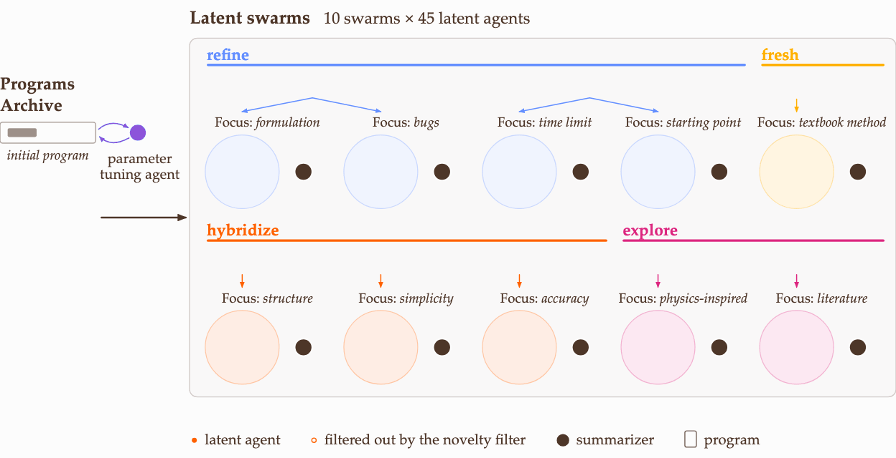

<h1>SwarmEvolve</h1>

<h3>Latent Agent Swarms for Rapid Evolutionary Search</h3>

Qile Jiang and George Em Karniadakis Division of Applied Mathematics, Brown University

 

  
   
  <i><a href="assets/method_overview.mp4">Step-by-step video with captions (43 s)</a></i>

 

**SwarmEvolve** is a super fast, low-cost, and capable framework for **LLM-guided evolutionary search**. It solves problems in mathematical discovery and scientific computing by refining and recombining existing programs.

**SwarmEvolve** uses **swarms of open-weight LLM agents**, hundreds of them per round, to reason in latent space. Each swarm studies the problem with a different focus and passes their KV caches to a summarizer agent that writes a new program, so the ideas of different agents combine directly in latent space.

## Results

  
   
  <i>Qwen3 8B, one GPU, 60 minutes per run.</i>

We compare SwarmEvolve with three open-source frameworks:

- **[OpenEvolve](https://github.com/algorithmicsuperintelligence/openevolve)**: A. Sharma, *OpenEvolve: an open-source evolutionary coding agent*, 2025.
- **[ShinkaEvolve](https://github.com/SakanaAI/ShinkaEvolve)**: R. T. Lange, Y. Imajuku, and E. Cetin, *ShinkaEvolve: Towards Open-Ended and Sample-Efficient Program Evolution*, International Conference on Learning Representations, 2026.
- **[CodeEvolve](https://github.com/inter-co/science-codeevolve)**: H. Assumpção, D. Ferreira, L. Campos, and F. Murai, *CodeEvolve: an open source evolutionary coding agent for algorithmic discovery and optimization*, arXiv:2510.14150, 2025.

On 21 problems from mathematical discovery and scientific computing, with Qwen3 8B, 14B, and 32B on one GPU for 60 minutes per run, SwarmEvolve achieves the highest average score with every model.

  
   
  <i>Best score within 60 minutes, averaged over three runs. Bold: best; underline: second best.</i>

## Benchmarks and baselines

- `benchmarks/problems/`: the 21 problems, each with `task.md`, `initial_program.py`, and `evaluator.py`.
- `benchmarks/evaluation.py`: the shared evaluation used to score every framework.
- `benchmarks/calibration/`: expert reference solvers for the scientific-computing problems.
- `baselines/`: OpenEvolve, ShinkaEvolve, and CodeEvolve at the commits used in the paper, with the scripts to run them on the benchmarks (`setup_baselines.sh`, then `run_baseline.sh <framework> <problem> <model>`).

## Code

The SwarmEvolve code will be released soon. For questions or early access, please reach out to the authors.
