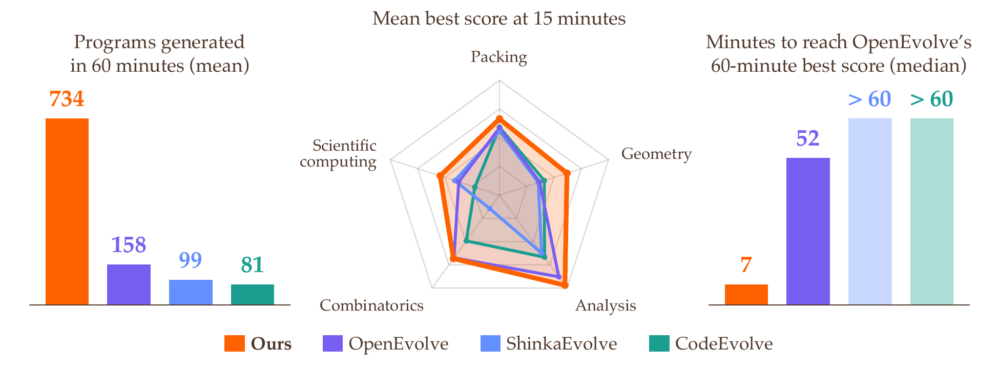

# SwarmEvolve

**Latent Agent Swarms for Rapid Evolutionary Search**\
Qile Jiang and George Em Karniadakis, Division of Applied Mathematics, Brown University

SwarmEvolve is a super fast, low-cost, and capable framework for LLM-guided evolutionary search. It solves problems in mathematical discovery and scientific computing by refining and recombining existing programs.

SwarmEvolve uses swarms of open-weight LLM agents, hundreds of them per round, to reason in latent space. Each swarm studies the problem with a different focus and passes their KV caches to a summarizer agent that writes a new program, so the ideas of different agents combine directly in latent space.

## Results

We compare SwarmEvolve with three open-source frameworks:

- **[OpenEvolve](https://github.com/algorithmicsuperintelligence/openevolve)**: A. Sharma, *OpenEvolve: an open-source evolutionary coding agent*, 2025.
- **[ShinkaEvolve](https://github.com/SakanaAI/ShinkaEvolve)**: R. T. Lange, Y. Imajuku, and E. Cetin, *ShinkaEvolve: Towards Open-Ended and Sample-Efficient Program Evolution*, International Conference on Learning Representations, 2026.
- **[CodeEvolve](https://github.com/inter-co/science-codeevolve)**: H. Assumpção, D. Ferreira, L. Campos, and F. Murai, *CodeEvolve: an open source evolutionary coding agent for algorithmic discovery and optimization*, arXiv:2510.14150, 2025.

On 21 problems from mathematical discovery and scientific computing, with Qwen3 8B, 14B, and 32B on one GPU for 60 minutes per run, SwarmEvolve achieves the highest average score with every model.

## Code

SwarmEvolve will be released soon. Please check back later! For questions or early access, please reach out to the author.
