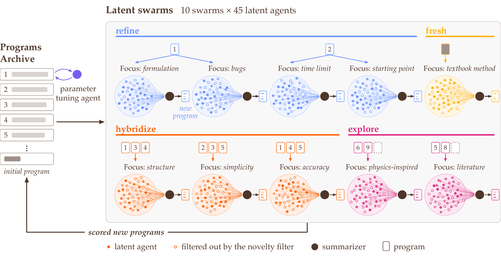
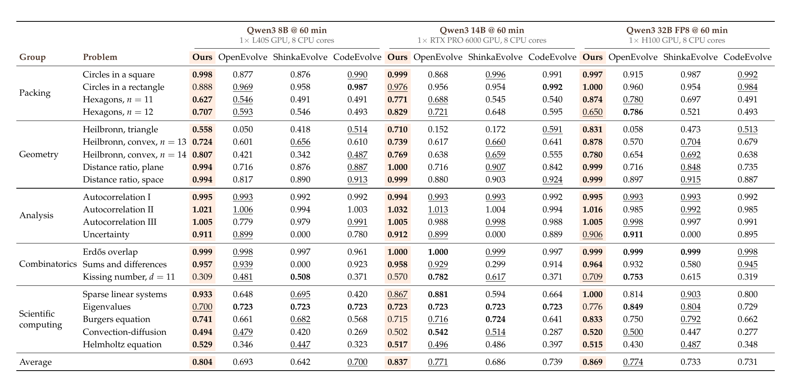

# SwarmEvolve: Latent Agent Swarms for Rapid Evolutionary Search

Qile Jiang and George Em Karniadakis, Division of Applied Mathematics, Brown University

LLM-guided evolutionary search improves programs for mathematical and computational problems, but the search is slow: the LLM decodes a long text response for every new program, and sampling one response at a time limits the diversity of the population. SwarmEvolve is a framework in which swarms of low-cost agents, hundreds of them per round, reason in latent space and communicate through KV cache transfers. Each swarm studies the problem with a different focus, and a novelty filter keeps the agents with the most distinct strategies by measuring the distances between their hidden states. Each swarm then passes the KV caches of its kept agents to a summarizer agent that writes a new program, so the ideas of different agents combine directly in latent space.

## Results

We compare SwarmEvolve with three open-source frameworks:

- **OpenEvolve**: A. Sharma, *OpenEvolve: an open-source evolutionary coding agent*, 2025. [github.com/algorithmicsuperintelligence/openevolve](https://github.com/algorithmicsuperintelligence/openevolve)
- **ShinkaEvolve**: R. T. Lange, Y. Imajuku, and E. Cetin, *ShinkaEvolve: Towards Open-Ended and Sample-Efficient Program Evolution*, International Conference on Learning Representations, 2026. [github.com/SakanaAI/ShinkaEvolve](https://github.com/SakanaAI/ShinkaEvolve)
- **CodeEvolve**: H. Assumpção, D. Ferreira, L. Campos, and F. Murai, *CodeEvolve: an open source evolutionary coding agent for algorithmic discovery and optimization*, arXiv:2510.14150, 2025. [github.com/inter-co/science-codeevolve](https://github.com/inter-co/science-codeevolve)

On 21 problems from mathematical discovery and scientific computing, with Qwen3 8B, 14B, and 32B on one GPU for 60 minutes per run, SwarmEvolve achieves the highest average score with every model. It evaluates 5 to 13 times more programs per hour than the three baselines and reaches their 60-minute scores in a median of 3 to 8 minutes. With Qwen3 8B, it surpasses the constructions that AlphaEvolve found with frontier models on three problems.

Best score within 60 minutes, averaged over three runs. On the 16 problems from AlphaEvolve, the score is the objective value relative to that of AlphaEvolve's published construction, so a score above 1 improves on AlphaEvolve. On the five scientific computing problems, the score is the number of correct digits relative to a high-fidelity reference solution, averaged over test cases. Bold marks the best and underline the second best score for each model.

## Code

The author will add the code, the benchmark problems, and the setups of the baselines to this repository soon. For questions or early access, please reach out to the author, [Qile Jiang](https://github.com/Qile-J).
